# Agentic Learning Flow

[](https://github.com/HayatullahFarahi/study-agent/generate)

A Copilot-powered study agent that helps you learn from your own books, PDFs, slide decks, long videos, and articles, and remembers exactly where you left off.

---

## Getting Started

<p align="center">
  
</p>

1. Open Copilot Chat and pick **Study Agent** in the agent picker.
2. Give it a material: `add <file, folder, or link>`. It extracts the text and detects the chapters, sections, slide groups, or video parts.
3. Confirm or edit the detected structure.
4. Choose how to start: study chapter 1, map the whole material first, or read a chapter summary.
5. Next time, just say **resume**.

---

## Demo

<p align="center">
  
</p>

A **demo article** is included so you can try it right after cloning. Pick **Study Agent** in the Chat agent picker and say:

```
resume demo                                   ← or run: /start-study demo
summarize unit 1.3 of demo                    ← cited study guide for the RAG section
what does the demo say about evaluation?      ← answer with section citations
quiz me on demo                               ← five questions, score recorded
done for today                                ← saves the exact resume point
```

No setup needed: the demo article ([demo/ai-engineering-intro/article.md](demo/ai-engineering-intro/article.md)) and its pre-built manifest live in `demo/`. On first use the agent copies the manifest to `temp/progress/demo/`, so your progress never changes the tracked files. It covers the AI engineering stack, prompting, Retrieval-Augmented Generation (RAG), evaluation, and going to production.

---

## How It Works

```
Add a material → text + structure extracted → summarize / study / ask / quiz → progress saved after every unit → "resume" next time
```

The **Study Agent** ([.github/agents/study-agent.agent.md](.github/agents/study-agent.agent.md)) is your tutor. Talk to it in plain language, for example "add ~/Downloads/ddia.pdf", "summarize chapter 3", "what does it say about quorums?", or "quiz me", and it routes each request to the matching **skill** in `.github/skills/`. The skills also work as slash commands from any agent.

- **Any material**: PDF books and papers, PowerPoint decks (with speaker notes), Word docs, Markdown and HTML, web articles, local video and audio, YouTube videos and playlists, course folders, and zips. Chapters, sections, slide groups, and video parts are detected automatically.
- **A tracker that resumes precisely**: progress is saved after every unit, with an exact resume point such as `p. 87`, `slide 14`, or `00:42:10`.
- **Precise summaries**: source-grounded study guides with citations, key terms, a diagram, and self-check questions, for one chapter or the whole material.
- **Ask the material**: answers come from the text with page, slide, or timestamp citations, and say so when the material doesn't cover something.
- **Built for engineers**: deep-dives go from intuition to mechanism, runnable code, trade-offs, and pitfalls.

---

## Prerequisites

| Requirement                                | Details                                                                                          |
| ------------------------------------------ | ------------------------------------------------------------------------------------------------ |
| **VS Code**                                | [Download](https://code.visualstudio.com/): a recent version with custom agents and agent skills |
| **GitHub Copilot**                         | Any plan: [get one here](https://github.com/features/copilot)                                    |
| **Python 3.9+** _(for non-text materials)_ | Runs the extraction script. The agent creates `.venv/` and installs only what a material needs   |

Python packages per format, installed on demand into `.venv/`:

| Material                        | Package                                                                                    |
| ------------------------------- | ------------------------------------------------------------------------------------------ |
| PDF                             | `pypdf`                                                                                    |
| PowerPoint `.pptx`              | `python-pptx`                                                                              |
| Word `.docx`                    | `python-docx`                                                                              |
| YouTube                         | `yt-dlp[default]`                                                                          |
| Video or audio without captions | `faster-whisper` (local transcription; downloads a model from huggingface.co on first use) |
| Summary → PDF export            | `markdown`, `weasyprint` (macOS also needs `brew install pango`)                           |

> **Note:** Pick **Study Agent** in the agent picker for the full experience. The slash commands work in any agent-mode chat, but not in inline chat.

---

## Folder Structure

```
<workspace-root>/
  .github/
    copilot-instructions.md     ← workspace conventions (paths, manifest, citations, tracker)
    agents/
      study-agent.agent.md      ← the Study Agent: persona, routing, learning paths
    skills/                     ← one workflow per slash command
      add-material/             ← + assets/manifest.template.json
      ingest-material/          ← + scripts/extract.py (PDF, PPTX, DOCX, video, YouTube, …)
      start-study/
      summarize-chapter/        ← + scripts/md_to_pdf.py
      ask-material/
      deep-dive/
      quiz-me/
      check-progress/
      save-note/
      ask-later/
      end-session/
  LEARNING-MATERIALS.md         ← guide for adding materials
  assets/demo.svg               ← animated demo shown above
  demo/ai-engineering-intro/    ← demo article + pre-built manifest (copied to temp/ on first use)
  learning-materials/           ← (gitignored) your PDFs, decks, videos, …
    <slug>/
      _extracted/               ← generated text with page/slide/time markers + outline
  temp/                         ← (gitignored) all generated study state
    Notes/<slug>/
      overview.md               ← one-page overview with unit status
      <NN>-<ch>-<concept>.md    ← concept notes (/save-note)
      qa-log.md                 ← answered questions (/ask-material)
      summary/                  ← chapter, unit, and full summaries (.md, optional .pdf)
    progress/
      _index.json               ← registry of materials
      <slug>/
        manifest.json           ← progress tracker (source of truth)
        session-log.md          ← tracked session history
        spotlight-log.md        ← deep-dive history
  .venv/                        ← (gitignored) Python environment for the scripts
```

---

## Slash Commands

Type `/` in Copilot Chat to see them. With the Study Agent selected you can also just describe what you want.

| Command                                                                     | What it does                                                                               |
| --------------------------------------------------------------------------- | ------------------------------------------------------------------------------------------ |
| `/add-material <file \| folder \| zip \| URL>`                              | Register a material: extract text, detect structure, create the manifest and `overview.md` |
| `/ingest-material <source>`                                                 | (Re-)extract text and structure from a PDF, deck, doc, video, YouTube link, or folder      |
| `/start-study [slug]`                                                       | Start or resume at the exact saved point (no slug = last material)                         |
| `/summarize-chapter <slug> chapter: <N> \| unit: <id> \| all [format: pdf]` | Precise, cited study summary of a chapter, unit, or the whole material                     |
| `/ask-material <question> [in <slug>]`                                      | Answer from the material's text, with citations                                            |
| `/deep-dive <topic> [in <slug>]`                                            | Grasp one concept in depth; no progress change                                             |
| `/quiz-me <slug> [chapter: <N> \| unit: <id> \| weak]`                      | Five source-grounded questions; score and weak areas are recorded                          |
| `/check-progress [slug]`                                                    | Progress, resume point, quiz history, summaries, pending questions                         |
| `/save-note <text> [in <slug>]`                                             | Save a key concept as a rich note                                                          |
| `/ask-later <question> [in <slug>]`                                         | Park a question for later                                                                  |
| `/end-session`                                                              | Save the session and the exact resume point                                                |

---

## Quick Start

With **Study Agent** selected:

```
add ~/Downloads/designing-data-intensive-applications.pdf   ← extracts text, detects chapters from bookmarks
add https://www.youtube.com/watch?v=<id>                   ← captions + chapters (or ~10-min parts)
add learning-materials/k8s-course/                          ← a folder: one module per file
summarize all of ddia                                       ← chapter summaries + full summary
resume                                                      ← continues exactly where you stopped
what does ddia say about leaderless replication?            ← cited answer from the text
explain consistent hashing like I'm an engineer             ← deep-dive, no progress change
quiz me on chapter 5                                        ← scored, weak areas tracked
done for today                                              ← saves the session and the resume point
```

Or with slash commands:

```
/add-material learning-materials/clean-code/clean-code.pdf
/start-study clean-code
/summarize-chapter clean-code chapter: 1 format: pdf
/quiz-me clean-code weak
/end-session
```

---

## How Progress Tracking Works

- **Checkpoint after every unit**: covered units, percent complete, and the next resume point are written to `manifest.json` as soon as a unit is done, so closing VS Code never loses progress.
- **Exact resume point**: stopping mid-unit saves the location and the last concept taught, for example `3.2 · p. 87 · after 'KV cache'; next: 'speculative decoding'`.
- **Quick saves**: "save progress", "note this", and "ask later" write to disk immediately.
- **Session history**: `/end-session` logs what you covered, updates `overview.md` statuses, and the index.
- **Quizzes feed the tracker**: scores and weak areas are stored, and the next session offers a quick review of them.
- **Deep-dive isolation**: `/deep-dive` never changes tracked progress.

---

## Teaching and Summary Style

Everything is grounded in the material and cited (`p. 42`, `slide 7`, `00:42:10`). Anything from outside the source is labeled 💬.

| Block                 | Purpose                                                            |
| --------------------- | ------------------------------------------------------------------ |
| 🎯 **Why it matters** | Motivates the concept before explaining it                         |
| 📌 **Concept**        | The author's definition or claim, in plain words, with citation    |
| Diagram               | ASCII diagram or table when there's structure, flow, or comparison |
| 💡 **Analogy**        | A real-world parallel, where it helps                              |
| 🔧 **In practice**    | Code or concrete usage                                             |
| ⚠️ **Common mistake** | Only when there's a real one                                       |
| 🧠 **Mental model**   | One sticky-note sentence                                           |

Summaries follow a study-guide layout: ⚡ TL;DR → 🗺️ big picture → 🔑 key ideas with citations → 📖 key terms → 🔗 connections → ✅ self-check questions → 🧠 mental model (plus 🎬 re-watch timestamps for videos).
